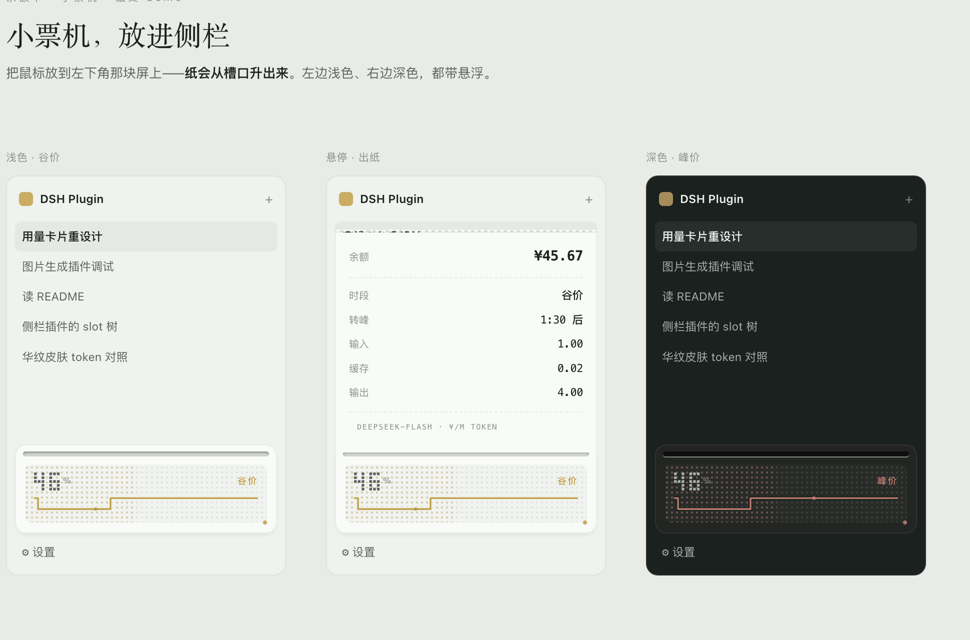

# dsh-usage-printer · 小票机用量卡

DSH 侧栏底部的一台小票机：静止时是一块点阵数字屏，鼠标放上去，纸从槽口升出来。



- **静止态**：点阵拼出的百分比 + 峰谷台阶带（淡黄＝谷价、淡红＝峰价），底纹点阵按用量亮起
- **悬停态**：一张小票，列出余额、已充值、时段、倒计时、可用天数、今日/本月花费、单价；点一下可以固定，Esc 或点外部收起
- 深浅色跟随 DSH 主题（`--dsw-alias-*`），窄栏时自动收成一个点阵小方块

## 数据从哪来

| 项目 | 来源 |
|---|---|
| 余额 | DeepSeek `GET /user/balance`，凭证用 DSH 账号登录留下的 grant 记录（`deepseek-account-platform/default`，请求头 `x-dsh-auth-token`） |
| 峰谷 | 官方价格表的窗口：北京时间工作日 09–12、14–18 为峰价 |
| 单价 | 官方 2026-09-10 价格快照（元 / 百万 token），表里没有的模型显示 `--` |

Host 半只注册一个本机路由 `GET /api/usage-printer`，30 秒缓存；Client 半 30 秒拉一次。
**余额不出本机**：路由只接受 localhost / 绑定主机名，响应不带任何跨域头。

## 安装

```bash
# GitHub（推荐，和你其它插件一致）
dsh plugin add github:bingomu/dsh-usage-printer#v1.0.3

# npm（可选）
npm i -g @bingomu/dsh-usage-printer

# 本地目录
# plugin_manager → install_bundle，target 指向这个目录
```

适配 DSH `0.2.1-rc.5`（`engines.dsh` 已声明）。

> ⚠️ 请安装 **v1.0.2 及以上**。v1.0.0 / v1.0.1 的客户端模块 id 写错，装上后侧栏不显示卡片。

## 已知限制

1. **节假日**：峰谷按“工作日”判定，没有接法定节假日表，调休日会算错档位。
2. **已充值**：DeepSeek 没有充值流水接口，这个数等于插件第一次读到你的余额（之后充值会自动更新）。装插件之前就有的余额，会偏低，导致百分比偏高。
3. **可用天数 / 今日 / 本月花费**：由余额采样差分推出，间隔超过 30 分钟的时段算“未观测”，该天的数字会带 `~` 前缀；更精确的口径要用会话日志（token × 当时的单价），见下。
4. **会话级花费**：尚未接会话日志。DSH 的 `assistant/message` 事件里带 `usage`，按事件发生时刻的单价计价才是准确口径，计划下一版做。
5. 单价是快照，官方调价后需要更新 `index.js` 里的 `PRICES`。

## 许可证

MIT
